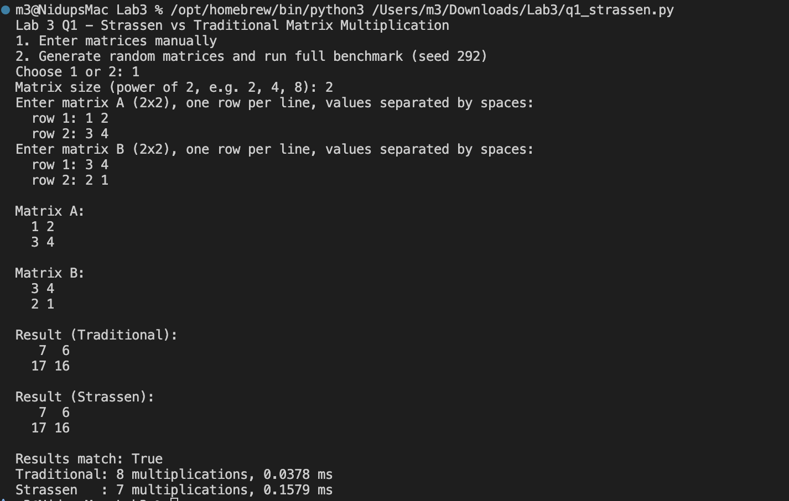
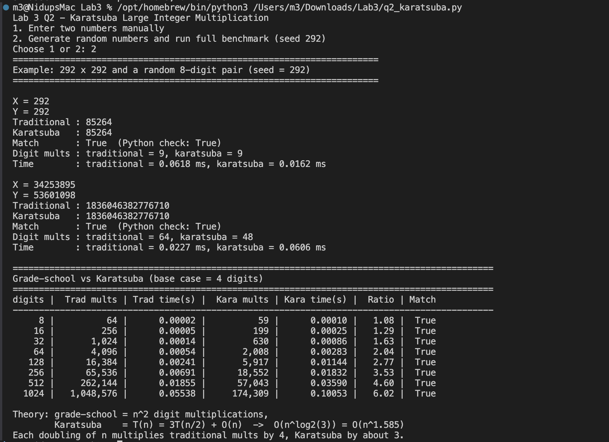
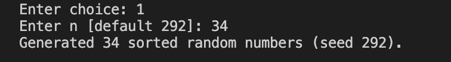
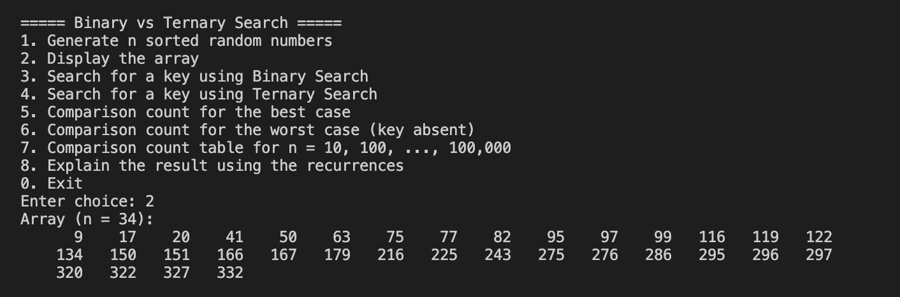
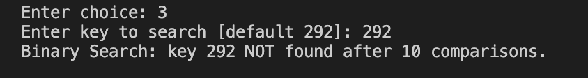
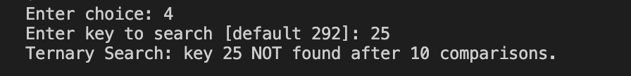
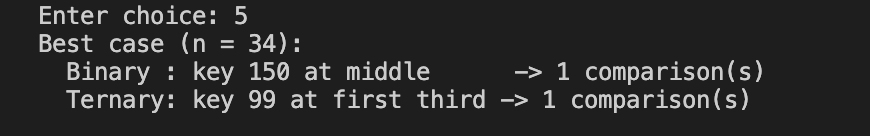
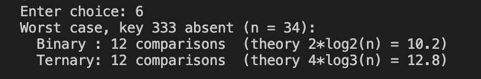
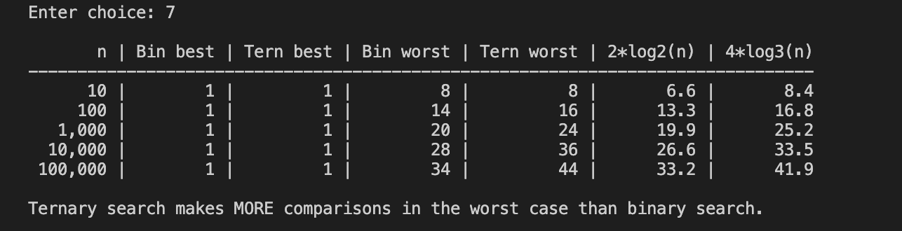
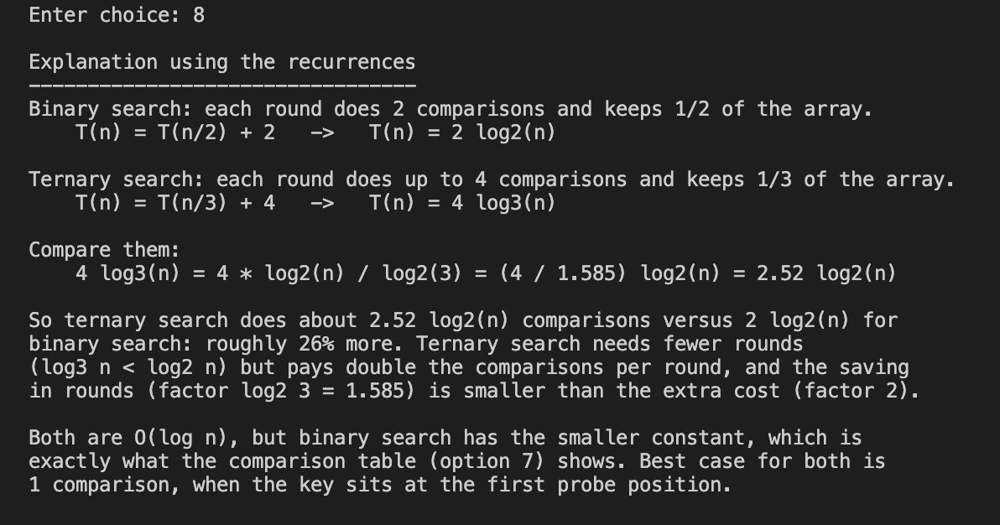

# Lab 3: Divide and Conquer (Python)

## Introduction

Divide and conquer solves a problem in three steps. It splits the problem into smaller subproblems, solves each one recursively, and combines the answers. This approach can beat a simple direct method, but only if the splitting is done cleverly.

In this lab I tested that idea on three problems:

1. **Matrix multiplication:** Strassen's algorithm compared with the traditional triple loop.
2. **Large integer multiplication:** Karatsuba's algorithm compared with grade-school multiplication.
3. **Searching a sorted array:** binary search compared with ternary search.

Each program checks that both methods give the same answer, counts the basic operations (multiplications or comparisons), and measures the running time. This lets me compare the real results with the theory.

## Files

| File | Question | Description |
|------|----------|-------------|
| `q1_strassen.py`  | Q1 | Strassen vs traditional matrix multiplication |
| `q2_karatsuba.py` | Q2 | Karatsuba vs grade-school large integer multiplication |
| `q3_search.py`    | Q3 | Binary vs ternary search (menu-driven) |

## How to run

You need Python 3. No extra packages are required.

```bash
python3 q1_strassen.py
python3 q2_karatsuba.py
python3 q3_search.py
```

## Notes

- Every script uses random seed **292**, so the results can be repeated.
- In Q1 and Q2, enter `1` to type the values yourself or `2` to use random data and run the full benchmark.
- In Q3, press Enter at a prompt to use the default value 292.

---

## Q1: Strassen vs Traditional Matrix Multiplication

- The traditional method uses three nested loops and does n³ scalar multiplications.
- Strassen's algorithm makes 7 recursive multiplications per split instead of 8, which gives O(n^log₂7) ≈ O(n^2.81).
- Matrix sizes are powers of 2, from 2×2 to 128×128.
- The program checks that both results match, counts the scalar multiplications, measures the time, and tries several base-case cutoffs to find the fastest one.

**Output (manual input, 2×2):**



I multiplied A = [[1, 2], [3, 4]] by B = [[3, 4], [2, 1]] by hand-entered input. Both methods give the same result, [[7, 6], [17, 16]]. Strassen uses **7** multiplications and the traditional method uses **8**. Strassen is still slower here (0.158 ms vs 0.038 ms) because computing its extra additions and subtractions costs more than the one multiplication it saves on such a small matrix.

## Q2: Karatsuba Large Integer Multiplication

- Integers are stored as digit strings, so there is no size limit.
- Karatsuba makes 3 recursive multiplications per split: T(n) = 3T(n/2) + O(n), which gives O(n^1.585).
- Both operands are padded to the same length in each recursive call. Numbers of 4 digits or fewer use grade-school multiplication.
- The benchmark runs on 8, 16, 32, …, 1024 digits.

**Output (random data and full benchmark):**



Both methods give the correct product for 292 × 292 and for a random 8-digit pair. The table shows how the gap grows with size. Each time the number of digits doubles, the traditional count goes up 4 times and Karatsuba's goes up about 3 times. At 1024 digits Karatsuba uses about **6 times fewer** digit multiplications (174,309 vs 1,048,576). It is still slower in real time because the string operations in Python are expensive, but its operation count follows O(n^1.585), as the theory predicts.

## Q3: Binary vs Ternary Search

Comparisons counted per round:

| Algorithm | Comparisons per round | Recurrence |
|-----------|----------------------|------------|
| Binary  | 2 (`== a[mid]`, `< a[mid]`) | T(n) = T(n/2) + 2 |
| Ternary | 4 (`== a[m1]`, `== a[m2]`, `< a[m1]`, `> a[m2]`) | T(n) = T(n/3) + 4 |

Ternary search uses fewer rounds, but it does more comparisons in each round. In the worst case it makes about 4·log₃n ≈ 2.52·log₂n comparisons, while binary search makes 2·log₂n. Binary search therefore does fewer comparisons.

### Menu

```
1. Generate n sorted random numbers
2. Display the array
3. Search for a key using Binary Search
4. Search for a key using Ternary Search
5. Comparison count for the best case
6. Comparison count for the worst case (key absent)
7. Comparison count table for n = 10, 100, ..., 100,000
8. Explain the result using the recurrences
0. Exit
```

### Screenshots

**1. Generate n sorted random numbers**



This generates an array of 34 distinct, sorted random numbers using seed 292.

**2. Display the array**



This shows the full menu and prints the 34 sorted numbers, from 9 to 332.

**3. Binary search**



Binary search for key 292. The key is not in the array, so the search ends after 10 comparisons.

**4. Ternary search**



Ternary search for key 25. The key is not in the array, and the search also ends after 10 comparisons.

**5. Best-case comparison count**



When the key is at the first position checked (the middle for binary search, the first third for ternary search), both searches need only **1 comparison**.

**6. Worst-case comparison count (key absent)**



For key 333, which is larger than every element, both searches make 12 comparisons when n = 34. The theory predicts 10.2 for binary search and 12.8 for ternary search. At this small size the two are close.

**7. Comparison table for n = 10 to 100,000**



The best case is always 1 comparison. In the worst case, ternary search falls further behind as n grows: at n = 100,000 it makes 44 comparisons and binary search makes 34. The measured counts follow the theoretical values 2·log₂n and 4·log₃n.

**8. Explanation using the recurrences**



This explains the result with the recurrences. Ternary search needs fewer rounds, but it does twice as many comparisons in each round. In total it makes about 2.52·log₂n comparisons, while binary search makes 2·log₂n, so ternary search does about 26% more work.

---

## What I learned

- **Fewer operations does not always mean faster.** Strassen and Karatsuba both use fewer multiplications than the direct methods, but they add extra additions, subtractions, copying and recursion calls. For small inputs the simple method wins, which is why a base-case cutoff matters.
- **Growth rate matters for large inputs.** The operation counts clearly matched the theory: n³ against n^2.81 for matrices, and n² against n^1.585 for integers. As the input grows, the gap keeps getting wider.
- **Splitting into more parts is not always better.** Ternary search splits the array into three parts, but it pays for this with 4 comparisons per round instead of 2. Since 4/log₂3 ≈ 2.52 is larger than 2, binary search does fewer comparisons.
- **Recurrences predict real behaviour.** Writing T(n) = aT(n/b) + f(n) and solving it gave numbers very close to what the programs measured.
- **Always check correctness.** Comparing every fast result with the simple method (and Python's built-in multiplication) gave me confidence that the recursive code was right before I looked at the timings.
- **A fixed random seed (292)** makes the experiments repeatable, so the screenshots and tables can be reproduced exactly.
